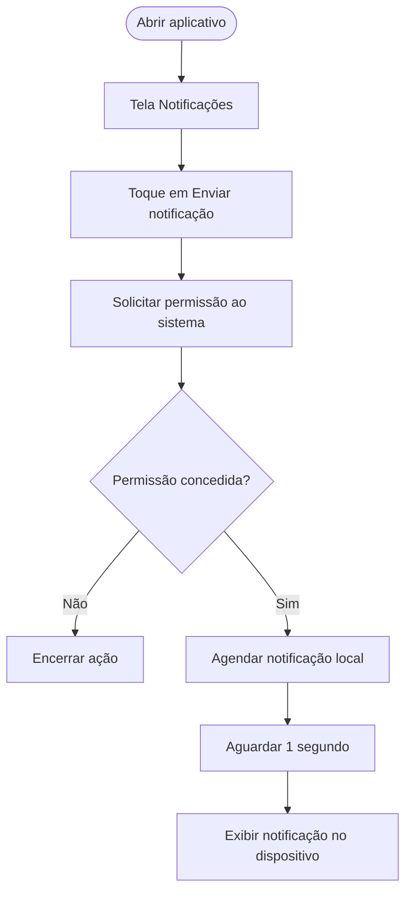

<div align="center">

# Notificações

**Aplicativo mobile para demonstração de notificações locais**

Desenvolvido com **React Native**, **Expo** e **TypeScript**.

[Visão geral](#sobre-o-projeto) · [Tecnologias](#tecnologias) · [Executar](#como-executar) · [Estrutura](#estrutura-do-projeto)

</div>

---

## Sobre o projeto

Aplicação mobile desenvolvida para a atividade prática **S1_R4 - AT1_PPDM2**. O aplicativo apresenta uma tela inicial simples, com um botão que solicita a permissão do sistema e agenda uma **notificação local** para ser exibida no dispositivo.

> [!NOTE]
> O projeto demonstra notificações locais agendadas no próprio aparelho. Ele não implementa envio de notificações push remotas por servidor.

## Captura de tela

<div align="center">


*Tela inicial — botão para disparar uma notificação local.*

</div>

## Funcionalidades

- Interface inicial com o título **Notificações**.
- Botão **Enviar notificação**.
- Solicitação de permissão para exibir notificações.
- Agendamento de uma notificação local para um segundo após o acionamento.
- Exibição da notificação como banner e na central/lista de notificações, conforme suporte do sistema.

## Fluxo de funcionamento



## Tecnologias

| Tecnologia | Aplicação |
|---|---|
| [React Native](https://reactnative.dev/) | Construção da interface mobile |
| [Expo SDK 58](https://docs.expo.dev/) | Ambiente e APIs nativas |
| [Expo Notifications](https://docs.expo.dev/versions/latest/sdk/notifications/) | Permissões e agendamento de notificações |
| [React 19](https://react.dev/) | Base da aplicação |
| [TypeScript 6](https://www.typescriptlang.org/) | Tipagem do projeto |

## Como executar

### Pré-requisitos

- [Node.js](https://nodejs.org/) em versão compatível com o Expo.
- npm.
- [Expo Go](https://expo.dev/go) ou ambiente nativo configurado.

### Instalação

Clone o repositório e acesse a pasta:

```bash
git clone https://github.com/iannxz/s1-s4-at1-ppdm2.git
cd s1-s4-at1-ppdm2
```

Instale as dependências:

```bash
npm ci
```

Inicie o servidor de desenvolvimento:

```bash
npx expo start
```

Leia o QR Code com o Expo Go ou execute em um ambiente configurado.

### Comandos disponíveis

| Comando | Descrição |
|---|---|
| `npm start` | Inicia o servidor Expo |
| `npm run android` | Inicia o projeto no Android |
| `npm run ios` | Inicia o projeto no simulador iOS (macOS) |
| `npm run web` | Inicia a versão web |

## Estrutura do projeto

```text
.
├── assets/
│   └── screenshots/
│       └── tela-notificacoes.png
├── src/
│   └── screens/
│       └── Home/
│           └── index.tsx
├── App.tsx
├── app.json
├── index.ts
├── package.json
├── package-lock.json
└── tsconfig.json
```

## Implementação da notificação

Ao pressionar o botão, a aplicação:

1. Solicita a permissão de notificações com `requestPermissionsAsync()`.
2. Verifica se a permissão foi concedida.
3. Agenda a notificação usando `scheduleNotificationAsync()`.
4. Define um intervalo de **1 segundo** para a exibição.

A notificação utiliza o título `Notificação` e a mensagem `Receba!!`.

---

<div align="center">

Desenvolvido como atividade prática de Programação para Dispositivos Móveis.

</div>
