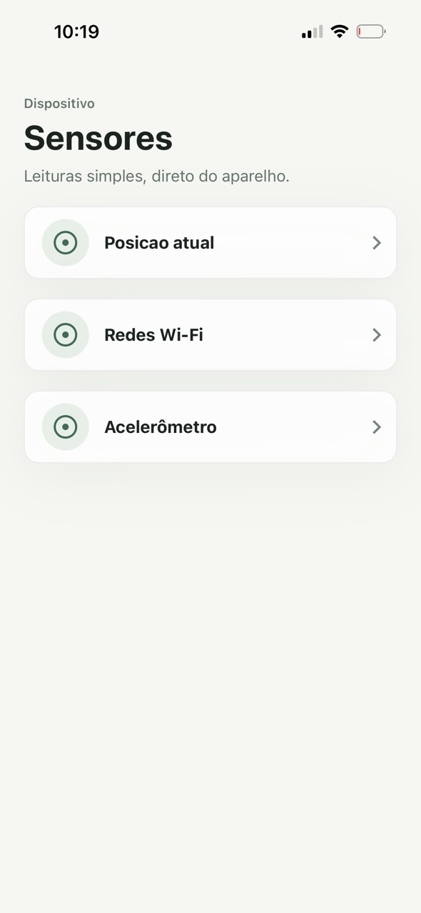
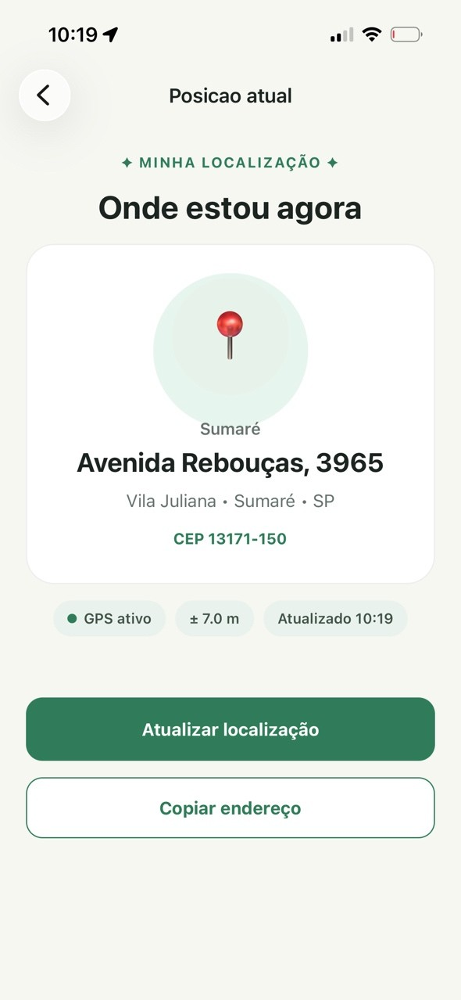
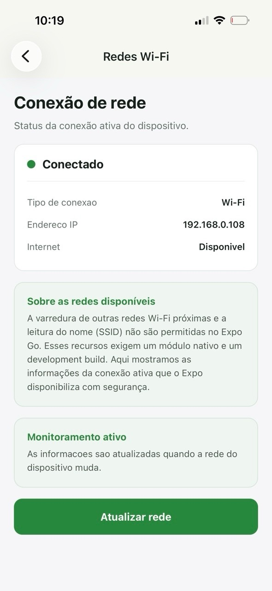
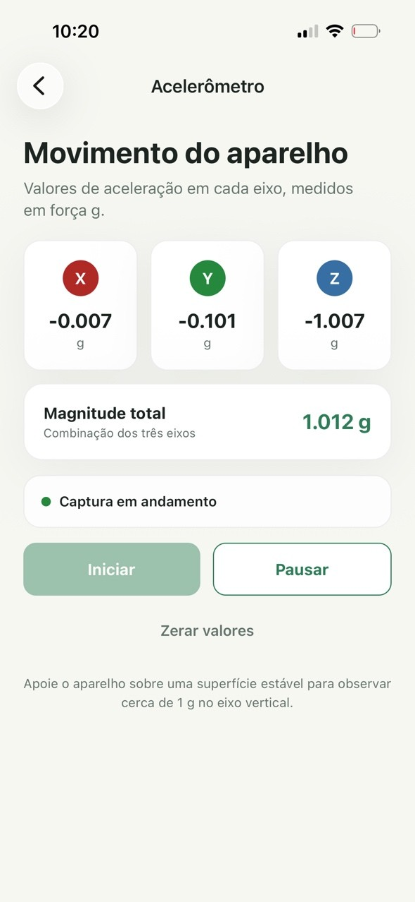

# Sensores do Dispositivo

Aplicativo mobile para consultar, de forma simples e visual, informações de localização, conectividade e movimento do aparelho.

**Expo 54 | React Native 0.81 | TypeScript 5.9**

## Sobre o projeto

O **Sensores do Dispositivo** reúne três experiências em uma aplicação React Native: posição atual por GPS, informações da conexão ativa e leitura do acelerômetro em tempo real.

O projeto utiliza Expo e navegação em pilha, possui tipagem estrita com TypeScript e trata estados de carregamento, indisponibilidade, permissões e erros diretamente na interface.

## Capturas de tela

<!-- Para atualizar a galeria, substitua os arquivos em assets/screenshots mantendo os mesmos nomes. -->

| Tela inicial | Posição atual | Conexão de rede | Acelerômetro |
| :---: | :---: | :---: | :---: |
|  |  |  |  |

## Funcionalidades

### Posição atual

- Solicitação de permissão de localização em primeiro plano;
- Captura da posição atual com precisão balanceada;
- Conversão das coordenadas em endereço por geocodificação reversa;
- Exibição da precisão do GPS e do horário da última atualização;
- Atualização manual da localização;
- Cópia do endereço completo para a área de transferência.

### Conexão de rede

- Identificação do tipo de conexão ativa;
- Indicação do estado da conexão e da disponibilidade de internet;
- Exibição do endereço IPv4 da interface principal;
- Monitoramento de alterações da rede;
- Consulta ao modo avião em dispositivos Android;
- Atualização manual das informações.

### Acelerômetro

- Leitura dos eixos **X**, **Y** e **Z** em força *g*;
- Cálculo da magnitude vetorial dos três eixos;
- Atualização das medições a cada 200 ms;
- Controles para iniciar, pausar e zerar os valores;
- Verificação da disponibilidade do sensor;
- Remoção segura do listener ao sair da tela.

## Tecnologias

| Tecnologia | Uso no projeto |
| --- | --- |
| [Expo SDK 58](https://docs.expo.dev/versions/v58.0.0/) | Ambiente de desenvolvimento e acesso às APIs nativas |
| [React Native 0.81](https://reactnative.dev/) | Construção da interface mobile |
| [React 19](https://react.dev/) | Componentes e gerenciamento de estado |
| [TypeScript 5.9](https://www.typescriptlang.org/) | Tipagem estática e modo estrito |
| [React Navigation 7](https://reactnavigation.org/) | Navegação entre as telas |
| [Expo Location](https://docs.expo.dev/versions/v58.0.0/sdk/location/) | Localização e geocodificação reversa |
| [Expo Network](https://docs.expo.dev/versions/v58.0.0/sdk/network/) | Estado da rede, conectividade e endereço IP |
| [Expo Sensors](https://docs.expo.dev/versions/v58.0.0/sdk/accelerometer/) | Leituras do acelerômetro |
| [Expo Clipboard](https://docs.expo.dev/versions/v58.0.0/sdk/clipboard/) | Cópia do endereço para a área de transferência |

## Como executar

### Pré-requisitos

- [Node.js](https://nodejs.org/) em uma versão LTS;
- npm;
- Expo Go compatível com o SDK 58 ou um ambiente nativo compatível;
- Um dispositivo físico é recomendado para testar corretamente GPS e acelerômetro.

### Instalação

```bash
git clone https://github.com/iannxz/s1_r1_at1_ppdm2.git
cd s1_r1_at1_ppdm2
npm ci
```

### Iniciando o projeto

```bash
npm start
```

Com o servidor do Expo aberto, escaneie o QR Code em um dispositivo compatível ou escolha uma das opções disponíveis no terminal.

## Scripts disponíveis

| Comando | Descrição |
| --- | --- |
| `npm start` | Inicia o servidor de desenvolvimento do Expo |
| `npm run android` | Abre o projeto no Android |
| `npm run ios` | Abre o projeto no simulador iOS, disponível no macOS |
| `npm run web` | Inicia a versão web, sujeita às limitações das APIs do navegador |

## Estrutura do projeto

```text
.
├── assets/
│   ├── screenshots/             # Capturas de tela usadas no README
│   └── ...                      # Ícones e imagens da aplicação
├── src/
│   └── screens/
│       ├── Acelerometro/         # Leitura dos eixos e magnitude
│       ├── Home/                 # Menu principal
│       ├── PosicaoGps/           # GPS, endereço e clipboard
│       └── RedesWifi/            # Estado e detalhes da conexão
├── types/
│   └── navigation.ts             # Tipagem das rotas
├── App.tsx                       # Navegação e configuração global
├── app.json                      # Configuração do Expo
├── index.ts                      # Ponto de entrada
├── package.json                  # Dependências e scripts
└── tsconfig.json                 # Configuração do TypeScript
```

## Permissões e limitações

- A tela de localização solicita acesso ao GPS enquanto o aplicativo está em uso. Sem essa permissão, a posição não pode ser exibida.
- A geocodificação reversa depende dos serviços de localização da plataforma e pode não retornar um endereço completo.
- O acelerômetro no iOS deve ser testado em um dispositivo físico.
- Emuladores e simuladores precisam de localização e sensores simulados para produzir leituras úteis.
- A consulta ao modo avião pela API utilizada está disponível apenas no Android.
- O Expo Go não permite varrer redes Wi-Fi próximas nem consultar seus SSIDs. A aplicação mostra somente informações da conexão ativa disponibilizadas pelo sistema.
- A experiência web possui restrições próprias do navegador; para validar todas as funcionalidades, prefira Android ou iOS.

## Privacidade

O aplicativo não possui backend nem persistência própria. As informações obtidas são usadas para exibição durante a execução e não são armazenadas pelo projeto.

## Autor

Desenvolvido por [@iannxz](https://github.com/iannxz).

---

<div align="center">
  Feito com React Native, Expo e TypeScript.
</div>
